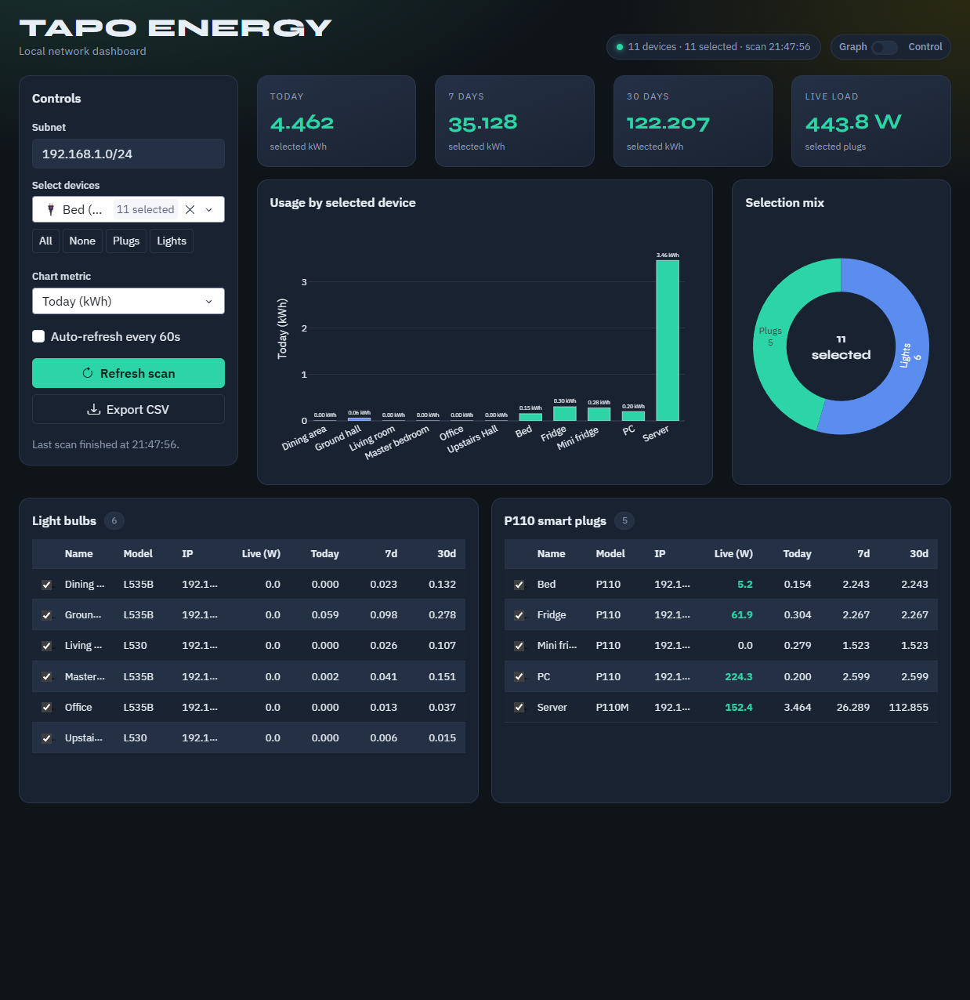
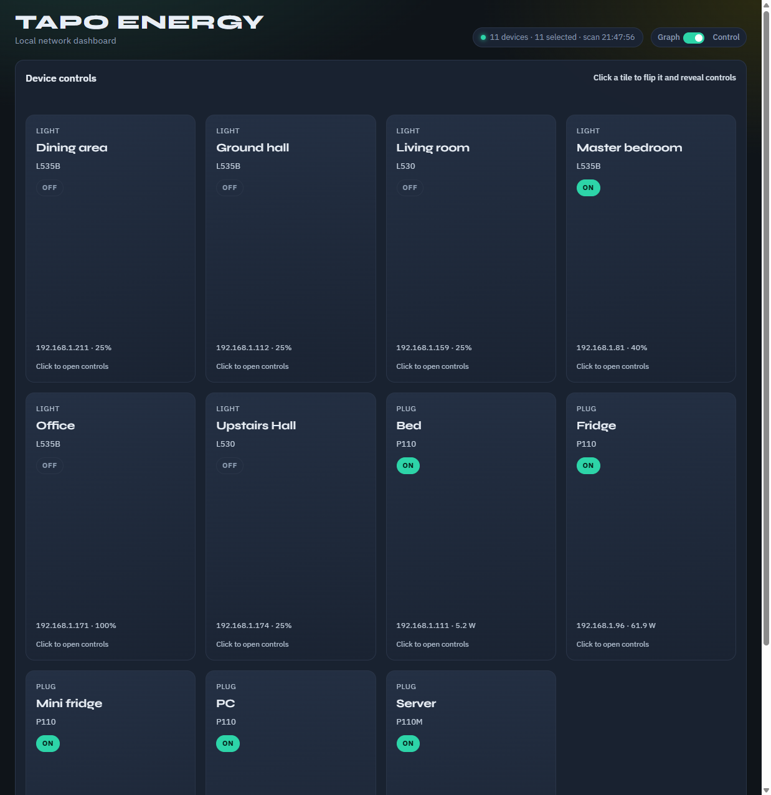
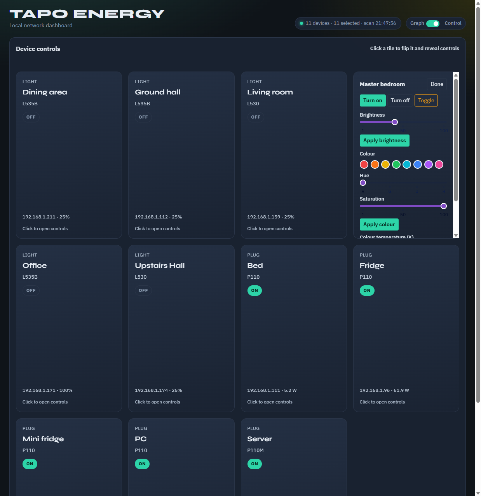

# Tapo Energy

Local network energy dashboard with full control of TP-Link Tapo bulbs and P110 smart plugs. Scan your LAN, chart usage, and flip device tiles to power, dim, and recolour lights — no cloud UI required once devices are on your network.



## Features

- **Discover** Tapo L-series bulbs and P110 / P110M plugs on a configurable subnet
- **Energy KPIs** for today, 7 days, 30 days, and live plug load (W)
- **Charts** — usage by device plus plug/light selection mix
- **Device tables** with live watts and historical kWh
- **Full device control** — on / off / toggle; brightness; colour presets + hue/sat; colour temperature
- **Export CSV** of the current scan
- Optional **60s auto-refresh**





## Supported devices

| Kind | Models |
|------|--------|
| Lights | L510, L520, L610, L430, L530, L535, L630, L900, L920, L930 |
| Plugs | P110, P115 (energy-monitoring plugs) |

## Setup

```bash
python -m venv .venv
# Windows
.\.venv\Scripts\activate
# macOS / Linux
source .venv/bin/activate

pip install -r requirements.txt
cp .env.example .env
```

Edit `.env` with your Tapo account credentials and subnet:

```env
TAPO_USERNAME=your_tapo_email@example.com
TAPO_PASSWORD=your_tapo_password_here
SUBNET=192.168.1.0/24
FLASK_HOST=0.0.0.0
FLASK_PORT=8080
```

`.env` is gitignored — keep secrets out of the repo. Use `.env.example` as the template.

Bind `0.0.0.0` so other devices on your LAN can open the dashboard (e.g. `http://<your-pc-ip>:8080`).

## Run

```bash
python app.py
```

Open [http://127.0.0.1:8080](http://127.0.0.1:8080) locally, or `http://192.168.1.91:8080` from another device on the network.

### LG webOS / Smart TV

Dash (React/Plotly) often fails on TV browsers and only shows the background. Use the lightweight TV UI instead:

- **http://192.168.1.91:8080/tv**
- Opening the root URL from a webOS / Smart TV user-agent auto-redirects to `/tv`
- Large buttons for on/off, brightness presets, and colour swatches (remote-friendly, no modern JS)

1. Click **Refresh scan** to discover devices on the subnet  
2. Select devices (or use All / Plugs / Lights) to drive KPIs and charts  
3. Toggle **Graph → Control** for flip-tile power and light controls  

## Project layout

| File | Role |
|------|------|
| `app.py` | Flask + Dash UI (graph view + control tiles) |
| `tapo_scanner.py` | LAN discovery, energy reads, device commands |
| `police_lights.py` | Optional red/blue flash demo for a colour bulb |
| `.env.example` | Env template |

## Notes

- Runs on your local network; the machine must reach device IPs on the same LAN/VLAN as the plugs and bulbs.
- First scan can take a minute on a `/24` subnet while devices are discovered and polled.
- `police_lights.py` is a standalone toy script (`POLICE_LIGHT_IP`, `POLICE_BRIGHTNESS`, `POLICE_INTERVAL` optional) — stop with Ctrl+C.
